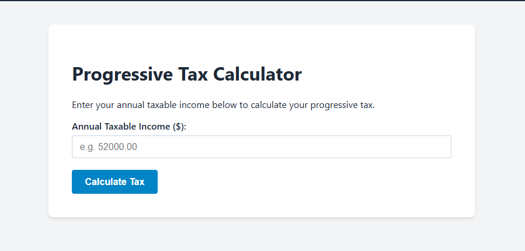
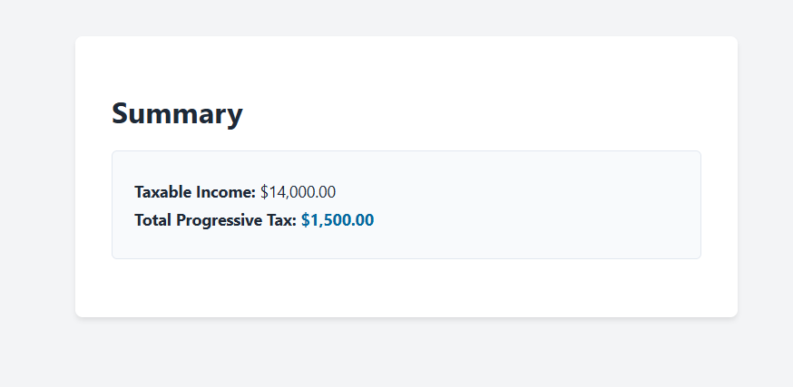
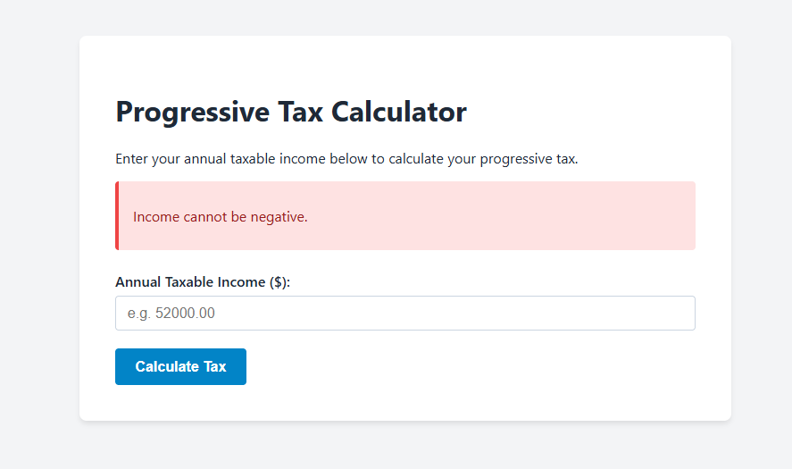

# Progressive Tax Calculator

This was built to work as a website that can calculate personal progressive tax while using a cumulative bracket.

## A. What it does
* Takes the amount given by a user's annual taxable income from an HTML form.
* It then applies a progressive tax across three different brackets
  * **Bracket 1:** $0 to $12,000 at 10%
  * **Bracket 2:** $12,000.01 to $45,000 at 15%
  * **Bracket 3:** $45,000.01 and up at 25%
* It will then apply cumulative calculations instead of a flat tax rate of total income. 
* Users must enter valid numbers or it is rejected by a server side validation that does not accept invalid or negative numbers. If these are entered the user is given an error with a HTTP 400 status. 
* It also ensures that income is formated and the calculated tax come out as currency, such as $26,000.00. 

## B. What it is built with
* **Python 3**
* **Flask** 
* **HTML5** and **CSS3**

## C. How to run it
1. **Clone the repository**
```bash
git clone https://github.com/txb39890-a11y/web143-project10.git
cd web143-project10

## D. Screenshots
### Home


### Results


### Invalid

